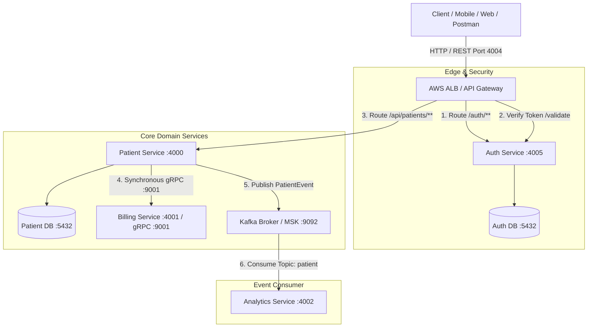
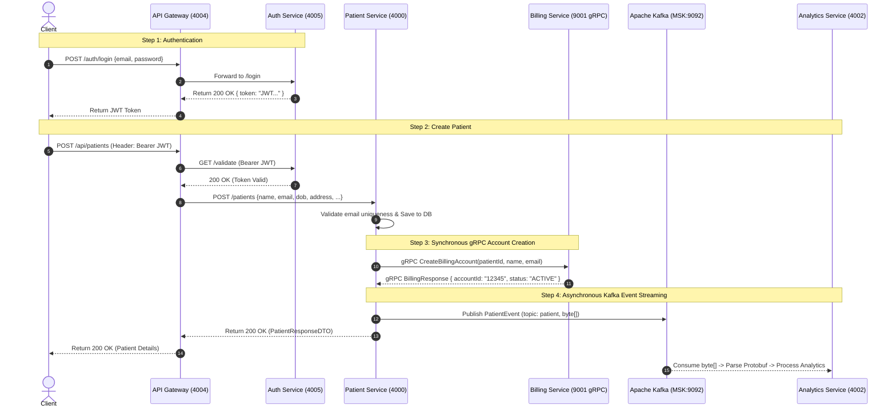

# Patient Management Microservices System — Comprehensive Project & Interview Preparation Guide

---

## 1. Project Overview & Business Purpose

The **Patient Management Microservices System** is an enterprise-grade, cloud-native backend platform designed to handle patient records, identity management, billing orchestration, and real-time event analytics.

Built using **Java 21** and **Spring Boot 3**, the system illustrates modern distributed systems design principles, including:
- **API Gateway Pattern:** Unified edge entry point for routing and auth offloading.
- **Microservices Decomposition:** Domain-driven boundaries separating Auth, Patient Management, Billing, and Analytics.
- **Database-per-Service:** Isolated PostgreSQL instances ensuring loose coupling and data autonomy.
- **Dual Inter-Service Communication:**
  - **Synchronous RPC via gRPC / HTTP2:** Low-latency, strongly-typed internal communication between Patient Service and Billing Service.
  - **Asynchronous Event-Driven Messaging via Apache Kafka:** Non-blocking event streaming using Google Protocol Buffers (Protobuf) serialization between Patient Service and Analytics Service.
- **Infrastructure as Code (IaC):** AWS Cloud Development Kit (CDK in Java) deploying to LocalStack (VPC, ECS Fargate, RDS PostgreSQL, MSK Kafka, ALB).

---

## 2. High-Level System Architecture



---

## 3. Microservices Breakdown

| Service Name | Port(s) | Key Technologies | Primary Responsibility |
| :--- | :--- | :--- | :--- |
| **`api-gateway`** | `4004` (HTTP) | Spring Cloud Gateway (Reactive/Netty), Spring WebClient | Single entry point, reverse proxy routing, token extraction, authentication enforcement. |
| **`auth-service`** | `4005` (HTTP) | Spring Boot Web, Spring Security, JJWT (0.12.6), Spring Data JPA, PostgreSQL | User authentication, BCrypt password hashing, JWT token issuance (`/login`) and verification (`/validate`). |
| **`patient-service`** | `4000` (HTTP) | Spring Boot Web, Spring Data JPA, PostgreSQL, gRPC Stub, Spring Kafka | CRUD operations on Patients, coordinates synchronous billing account creation, publishes audit events to Kafka. |
| **`billing-service`** | `4001` (HTTP), `9001` (gRPC) | Spring Boot, `net.devh:grpc-spring-boot-starter`, Protobuf | Exposes gRPC server implementing `BillingServiceGrpc.BillingServiceImplBase` to provision billing accounts. |
| **`analytics-service`** | `4002` (HTTP) | Spring Boot, Spring Kafka, Protobuf | Subscribes to the `patient` topic, deserializes binary protobuf payloads, and processes streaming analytics events. |
| **`infrastructure`** | — | AWS CDK (Java 21), LocalStack, Docker | Programmatic infrastructure definition (VPC, ECS Fargate clusters, RDS Postgres, MSK, ALB, Route53 health checks). |
| **`integration-tests`** | — | JUnit 5, REST-Assured | Black-box automated end-to-end integration tests verifying gateway routing and security workflows. |

---

## 4. In-Depth Service Analysis

### 4.1. API Gateway (`api-gateway`)
- **Port:** `4004`
- **Routing Engine:** Spring Cloud Gateway (built on Spring WebFlux and Netty for non-blocking I/O).
- **Core Route Definitions (`application.yml`):**
  - `/auth/**` $\rightarrow$ `http://auth-service:4005` (StripPrefix=1)
  - `/api/patients/**` $\rightarrow$ `http://patient-service:4000` (StripPrefix=1, guarded by `JwtValidation` filter)
  - `/api-docs/patients` $\rightarrow$ `http://patient-service:4000/v3/api-docs`
  - `/api-docs/auth` $\rightarrow$ `http://auth-service:4005/v3/api-docs`
- **Custom Security Filter (`JwtValidationGatewayFilterFactory`):**
  - Intercepts requests on protected routes.
  - Checks for the `Authorization: Bearer <token>` header. If missing, immediately returns `401 Unauthorized`.
  - Uses reactive `WebClient` to call `auth-service` endpoint `/validate` with the token.
  - If valid (HTTP 200), the request is forwarded downstream; otherwise, the request is terminated with `401`.

### 4.2. Auth Service (`auth-service`)
- **Port:** `4005`
- **Database:** PostgreSQL (`auth-service-db`)
- **Key Files:**
  - `AuthController.java`: Endpoints `POST /login` and `GET /validate`.
  - `AuthService.java`: Validates user against database via `UserService`, verifies hashed password with `BCryptPasswordEncoder`, and generates JWT using `JwtUtil`.
  - `SecurityConfig.java`: Configures `SecurityFilterChain` permitting all raw requests at HTTP layer while relying on controller logic and disabled CSRF for stateless REST.
  - `data.sql`: Automatically seeds default admin user (`testuser@test.com` / `password123`).
- **Token Contract:** Signed with HMAC-SHA secret (`JWT_SECRET`), contains claims for `email` and `role` (e.g. `ADMIN`).

### 4.3. Patient Service (`patient-service`)
- **Port:** `4000`
- **Database:** PostgreSQL (`patient-service-db`)
- **Entities & Validation:**
  - `Patient`: `id` (UUID), `name`, `email` (unique), `address`, `dateOfBirth`, `registeredDate`.
  - Validation groups: `CreatePatientValidationGroup` requires `registeredDate` on creation, while `updatePatient` restricts modifications.
- **Exception Handling:**
  - `GlobalExceptionHandler` handles `EmailAlreadyExistsException` (returns 409 Conflict), `PatientNotFoundException` (returns 404 Not Found), and validation binding errors.
- **Downstream Integrations:**
  - **gRPC Client (`BillingServiceGrpcClient.java`):**
    - Connects to `billing-service` on port `9001` via `ManagedChannel`.
    - Creates a `BillingRequest` protobuf message (`patientId`, `name`, `email`).
    - Executes a blocking stub call: `billingStub.createBillingAccount(request)`.
  - **Kafka Producer (`KafkaProducer.java`):**
    - Builds `PatientEvent` protobuf object (`patientId`, `name`, `email`, `eventType = PATIENT_CREATED`).
    - Serializes message to byte array: `event.toByteArray()`.
    - Publishes to Kafka topic `patient`.

### 4.4. Billing Service (`billing-service`)
- **Ports:** `4001` (HTTP Management), `9001` (gRPC Server)
- **gRPC Contract (`billing_service.proto`):**
  ```protobuf
  syntax = "proto3";
  service BillingService {
    rpc CreateBillingAccount (BillingRequest) returns (BillingResponse);
  }
  message BillingRequest {
    string patientId = 1;
    string name = 2;
    string email = 3;
  }
  message BillingResponse {
    string accountId = 1;
    string status = 2;
  }
  ```
- **Implementation (`BillingGrpcService.java`):**
  - Annotated with `@GrpcService` from `net.devh:grpc-spring-boot-starter`.
  - Implements `createBillingAccount(BillingRequest, StreamObserver<BillingResponse>)`.
  - Returns simulated active billing account (`accountId="12345"`, `status="ACTIVE"`).

### 4.5. Analytics Service (`analytics-service`)
- **Port:** `4002`
- **Protobuf Schema (`patient_event.proto`):**
  ```protobuf
  syntax = "proto3";
  package patient.events;
  message PatientEvent {
    string patientId = 1;
    string name = 2;
    string email = 3;
    string event_type = 4;
  }
  ```
- **Consumer (`KafkaConsumer.java`):**
  - Listens to topic `patient` with consumer group `analytics-service`.
  - Deserializes raw byte payloads using `PatientEvent.parseFrom(event)`.
  - Logs event attributes (`patientId`, `name`, `email`) and acts as a foundation for auditing, reporting, or event sourcing.

### 4.6. Infrastructure as Code (`infrastructure`)
- **Stack:** AWS Cloud Development Kit (CDK) v2 in Java, compiled into CloudFormation templates targeting **LocalStack**.
- **Resources Provisioned (`LocalStack.java`):**
  - **VPC (`PatientManagementVPC`):** Spans 2 Availability Zones with isolated subnets.
  - **Databases:** Two AWS RDS PostgreSQL 17.2 Micro instances (`auth-service-db` and `patient-service-db`).
  - **Health Checks:** Route53 TCP health checks for RDS endpoints before container boot.
  - **Kafka (MSK):** AWS Managed Streaming for Apache Kafka (`CfnCluster`).
  - **ECS Cluster (`PatientManagementCluster`):** AWS Fargate tasks running containerized microservices with CloudWatch logs (`/ecs/<service>`) and CloudMap private DNS (`patient-management.local`).
  - **Application Load Balancer (ALB):** Public internet-facing load balancer routing to `api-gateway` on port 4004.

---

## 5. End-to-End Workflow & Data Flow

### Patient Registration Sequence:



---

## 6. Comprehensive API Reference

### 1. Authentication Endpoints (`auth-service` via Gateway)
- **Login:**
  - `POST http://<gateway-host>:4004/auth/login`
  - Body:
    ```json
    {
      "email": "testuser@test.com",
      "password": "password123"
    }
    ```
  - Response (200 OK):
    ```json
    {
      "token": "eyJhbGciOiJIUzI1NiJ9..."
    }
    ```
- **Validate Token:**
  - `GET http://<gateway-host>:4004/auth/validate`
  - Header: `Authorization: Bearer <token>`
  - Response: `200 OK` or `401 Unauthorized`

### 2. Patient Endpoints (`patient-service` via Gateway)
- **Get All Patients:**
  - `GET http://<gateway-host>:4004/api/patients`
  - Header: `Authorization: Bearer <token>`
  - Response (200 OK): Array of Patient objects.
- **Create Patient:**
  - `POST http://<gateway-host>:4004/api/patients`
  - Header: `Authorization: Bearer <token>`
  - Body:
    ```json
    {
      "name": "John Doe",
      "email": "john.doe@example.com",
      "address": "123 Main Street",
      "dateOfBirth": "1995-09-09",
      "registeredDate": "2025-01-15"
    }
    ```
  - Response (200 OK): Newly created Patient DTO with generated UUID.
- **Update Patient:**
  - `PUT http://<gateway-host>:4004/api/patients/{id}`
  - Header: `Authorization: Bearer <token>`
- **Delete Patient:**
  - `DELETE http://<gateway-host>:4004/api/patients/{id}`
  - Header: `Authorization: Bearer <token>`
  - Response: `204 No Content`

### 3. API Documentation Endpoints
- Swagger / OpenAPI for Patients: `GET http://<gateway-host>:4004/api-docs/patients`
- Swagger / OpenAPI for Auth: `GET http://<gateway-host>:4004/api-docs/auth`

---

## 7. Technical Interview & Exam Q&A Preparation Cheat Sheet

### Q1: Why use gRPC for communication between Patient Service and Billing Service instead of standard REST/JSON?
**Answer:**
- **Performance & Latency:** gRPC operates over HTTP/2 with multiplexed streams, binary framing, and header compression (HPACK), making it significantly faster with less overhead than text-based REST/JSON.
- **Strict Schema Contract:** Protobuf definitions (`billing_service.proto`) enforce compile-time safety and automatic code generation across client and server stubs, eliminating runtime serialization mismatches.
- **Synchronous Dependency:** Billing account creation is a required immediate step before confirming patient onboarding, making a low-latency blocking RPC ideal.

### Q2: Why use Kafka and Protobuf for Analytics instead of REST or gRPC?
**Answer:**
- **Decoupling & Non-blocking:** Analytics operations should not slow down or block the primary patient creation transaction. If Analytics is temporarily down, patient creation must continue without failure.
- **Durability & Buffering:** Kafka provides persistent log storage and allows downstream services to consume at their own rate without message loss.
- **Efficient Binary Serialization:** Google Protobuf produces compact binary payloads compared to JSON, optimizing network throughput and disk I/O on Kafka brokers.
- **Scalability / Pub-Sub:** Additional consumers (e.g. Email Notification Service, Audit Log Service) can subscribe to the same `patient` topic without requiring modifications to `patient-service`.

### Q3: How does the API Gateway handle authentication, and what are the trade-offs?
**Answer:**
- **Mechanism:** Spring Cloud Gateway uses a custom filter (`JwtValidationGatewayFilterFactory`). When a request arrives at `/api/patients/**`, the filter extracts the `Bearer` token and makes a non-blocking reactive HTTP request to `auth-service/validate`.
- **Trade-off Analysis:**
  - *Advantage:* Downstream services (like `patient-service`) do not need to store the JWT secret or manage authentication verification logic, keeping them lean.
  - *Trade-off (Network Hop):* Calling `auth-service` on every request introduces a network hop. *Production optimization:* The gateway could validate JWT signatures locally using a shared secret or public key (JWKS / asymmetric RSA/ECDSA), only calling Auth Service for revocations or blacklists.

### Q4: How is Database-per-Service implemented, and why is it important?
**Answer:**
- `auth-service` and `patient-service` connect to independent PostgreSQL databases (`auth-service-db` and `patient-service-db`).
- **Benefits:**
  - **Fault Isolation:** An outage or maintenance on the patient database does not bring down user authentication.
  - **Independent Scaling & Schema Evolution:** Teams can alter schemas or migrate database engines without impacting other services.
  - **Domain Autonomy:** Prevents foreign-key dependencies and direct queries across microservice boundaries.

### Q5: How is AWS Cloud Infrastructure defined and deployed locally?
**Answer:**
- The `infrastructure` module uses **AWS CDK in Java 21**.
- `LocalStack.java` builds CloudFormation constructs: VPC, ECS Fargate clusters, RDS Postgres databases, Route53 health checks, MSK Kafka broker, and Application Load Balancer.
- The synthesis produces `./cdk.out/localstack.template.json`, which is deployed to **LocalStack** via AWS CLI using `localstack-deploy.sh`, enabling cloud-native testing locally without incurring AWS cloud costs.

---

## 8. Summary Checklist for Presenting / Revising this Project

1. **System Type:** Enterprise Healthcare Microservices Platform.
2. **Languages & Frameworks:** Java 21, Spring Boot 3.3+, Spring Cloud Gateway, Spring Security 6, Spring Data JPA, Spring Kafka.
3. **Protocols & Serialization:** REST (HTTP/1.1 & HTTP/2), gRPC (HTTP/2 binary), Protocol Buffers (v3), Apache Kafka.
4. **Databases:** PostgreSQL 17 (multi-instance, containerized / RDS).
5. **Security:** Stateless JWT authentication, BCrypt password hashing, Gateway token verification filter.
6. **Infrastructure & Deployment:** Multi-stage Dockerfiles, AWS CDK (Java), LocalStack, AWS ECS Fargate, AWS RDS, AWS MSK, AWS ALB.
7. **Testing:** Unit tests (JUnit 5, Mockito), End-to-end integration tests (REST-Assured).
